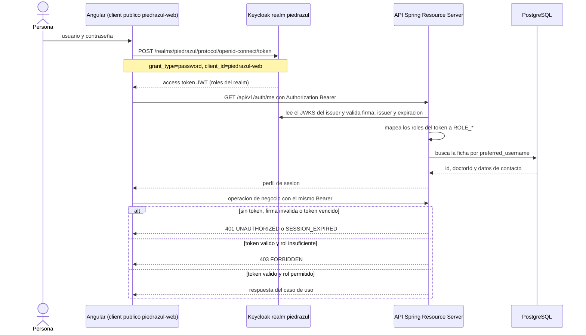
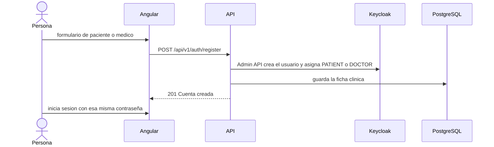

# Flujo de autenticacion

Diagrama del camino que queda despues de retirar el token local. La captura de pantalla del realm o del login se toma en la maquina de quien sustenta, con Keycloak y la app en ejecucion; este diagrama es la referencia del flujo.

Registro de una cuenta nueva:

